<p align="center">
  
</p>

# Awesome Deep Learning Deployment & Model Serving [](https://awesome.re) [](https://opensource.org/licenses/MIT) [](https://github.com/ishandutta2007/Awesome-Deep-Learning-Deployment/pulls) [](https://github.com/ishandutta2007/Awesome-Deep-Learning-Deployment/stargazers)

> A comprehensive, production-tested directory of the best tools, frameworks, and hosted platforms for **Deep Learning Deployment**, **LLM Inference Optimization**, **Model Graph Compilation**, and **Production Model Serving** across Cloud, Kubernetes, and Edge hardware.

[](#open-source-github-projects)
[](#open-source-github-projects)
[](#open-source-github-projects)
[](#open-source-github-projects)
[](#saashosted-platforms)

**Last updated: October 2026**

This repository tracks the modern **Deep Learning Deployment Ecosystem**. It is designed for Machine Learning Engineers, MLOps Practitioners, and Platform Architects who need to deploy trained deep learning and Large Language Models (LLMs) into production with minimal latency, maximum token throughput, and cost-efficient hardware utilization.

---

## Table of Contents

- [Sector Overview & Market Dynamics](#sector-overview--market-dynamics)
- [Deployment Architecture & Decision Matrix](#deployment-architecture--decision-matrix)
- [SaaS/Hosted Platforms](#saas-hosted-platforms)
- [Open-Source GitHub Projects](#open-source-github-projects)
- [Production Architecture Integration Patterns](#production-architecture-integration-patterns)
- [Frequently Asked Questions (FAQ) & Deployment Insights](#frequently-asked-questions-faq--deployment-insights)
- [How to Contribute](#how-to-contribute)
- [Disclaimer & Evaluation Framework](#disclaimer--evaluation-framework)

---

## Sector Overview & Market Dynamics

The global deep learning inference and AI model deployment market is estimated at **$95B–$120B in 2024–2026** and projected to reach **$250B–$490B+ by the early 2030s** (~17%–19% CAGR), with production inference representing **80%–90% of total lifetime enterprise AI computing expenditure**. 

The sector exhibits a bifurcated competitive structure: the **hardware accelerator and silicon tier is highly concentrated and monopolistic** (dominated by NVIDIA with 55%–75% market share alongside hyperscaler custom ASICs), whereas the **software compilation, orchestration, and inference runtime tier is moderately-to-highly fragmented** across hardware-agnostic compilers, open-source serving engines, and specialized serverless platforms competing on latency, throughput, and cost-per-token optimization.

## Deployment Architecture & Decision Matrix

| Workload & Target | Recommended Engine / Framework | Key Architectural Advantage | Primary Trade-Off |
| :--- | :--- | :--- | :--- |
| **High-Throughput Enterprise LLM Serving** | **vLLM** | PagedAttention, continuous batching, chunked prefill | High GPU VRAM allocation required |
| **Agentic Workflows & Multi-Turn Chat** | **SGLang** | RadixAttention (automatic KV cache prefix reuse) | Rapidly evolving API surface |
| **CPU / Edge / Local Laptop LLM** | **llama.cpp** / **Ollama** | GGUF quantization (2-bit to 8-bit), zero runtime dependencies | Slower throughput than distributed GPU serving |
| **Multi-Framework Enterprise Model Server** | **Triton Inference Server** | Heterogeneous backends (TensorRT, ONNX, vLLM, Python), dynamic batching | Operational complexity for setup & tuning |
| **NVIDIA GPU Peak Performance** | **NVIDIA TensorRT** | Layer fusion, kernel auto-tuning for Ampere/Hopper/Blackwell | Hardware vendor lock-in to NVIDIA GPUs |
| **Hardware-Agnostic Model Compilation** | **Apache TVM** | TensorIR + Relax dual IR, compiles to any CPU/GPU/NPU/DSP | Steeper compiler learning curve |
| **Cross-Platform Model Portability** | **ONNX Runtime** | Universal model format, automatic execution provider selection | May trail single-hardware vendor-optimized peak speeds |
| **Intel CPU / Arc GPU / NPU Acceleration** | **Intel OpenVINO** | AVX-512, AMX, Intel Arc & Core Ultra NPU optimization | Tailored exclusively for Intel architecture |
| **Mobile & Embedded PyTorch Edge** | **ExecuTorch** | Tiny binary footprint (<50 KB), direct PyTorch 2.x export | Newer ecosystem compared to older mobile toolkits |
| **Kubernetes Declarative Serving** | **KServe** / **Seldon Core** | Scale-to-zero, Canary rollouts, declarative CRDs on Istio/Knative | Requires operational Kubernetes cluster |

## SaaS/Hosted Platforms

| Platform / Product | Company Size / Valuation / Revenue | Primary Focus / Deployment Scope | Starting Pricing | Free Tier / Trial Limits |
| :--- | :--- | :--- | :--- | :--- |
| **[NVIDIA NIM & AI Enterprise](https://www.nvidia.com/en-us/ai-data-science/products/nim/)** | ~$3.4 Trillion Market Cap ($120B+ ARR) | Optimized inference microservices and containerized deployment across NVIDIA GPUs | $1.00 per GPU-hour or $4,500 per GPU/year | 90-day free trial with 5,500 credits for NVIDIA AI Foundation Models; free local testing via NGC for research/individual use |
| **[Microsoft Azure AI Foundry & Azure ML](https://azure.microsoft.com/en-us/products/ai-foundry)** | ~$3.1 Trillion Market Cap ($140B+ Cloud ARR) | Managed enterprise model serving, ONNX Runtime integration, and Triton on AKS | $0.096/hour (`Standard_D2s_v5` CPU) or $0.38/hour (`Standard_NC4as_T4_v3` GPU) | 30-day free trial with $200 Azure credits, plus 12 months access to popular free services |
| **[Google Cloud Vertex AI](https://cloud.google.com/vertex-ai)** | ~$2.1 Trillion Market Cap ($40B+ Cloud ARR) | Managed serverless and dedicated endpoints for Gemma, PaLM, Gemini, and custom deep learning models | $0.0005 per 1k characters or $0.74/hour (`n1-standard-4` + NVIDIA T4 GPU) | 90-day free trial with $300 universal Google Cloud credits for new accounts |
| **[AWS SageMaker & Bedrock](https://aws.amazon.com/sagemaker/)** | ~$2.1 Trillion Market Cap ($105B+ AWS ARR) | Real-time, asynchronous, and serverless deep learning endpoints with AWS Neuron & GPU support | $0.05/hour (`ml.t3.medium` CPU) or $0.526/hour (`ml.g4dn.xlarge` GPU) | 2 months free trial with 250 hours/month of `ml.t3.medium` instances under AWS Free Tier |
| **[Fireworks AI](https://fireworks.ai/)** | $17.5 Billion Valuation ($1.5B Series D, $1B+ ARR) | Low-latency generative model serving, compound AI systems, and custom LoRA adapter hosting | $0.20 per 1M tokens (Llama 3 8B) or $0.00055/GPU-sec for on-demand dedicated deployments | $1 free starter credit upon account registration (approx. 5M tokens on 8B models); no expiry date |
| **[Modal](https://modal.com/)** | $15.75 Billion Valuation ($750M Series D, $1B+ ARR) | Serverless Python-defined container infrastructure with sub-second cold starts and scale-to-zero | $0.000163/core-sec CPU, $0.000588/sec for NVIDIA T4 (~$2.12/hr), $0.001097/sec for A10G | $30/month in free compute credits renewing forever; up to 10 concurrent GPUs and 3 workspace seats |
| **[Baseten](https://www.baseten.co/)** | $13.0 Billion Valuation ($1.5B Series F) | Production model serving backed by Truss packaging, Triton engine, and zero-idle cost scaling | $0.20 per 1M tokens or $0.033/min ($1.98/hour) for dedicated NVIDIA A10G instances | $30 free compute credits upon account creation for testing serverless deployments |
| **[Together AI](https://www.together.ai/)** | $8.3 Billion Valuation ($800M Series C) | Serverless open-source model inference endpoints and dedicated multi-GPU serving clusters | $0.18 per 1M tokens (Llama 3.1 8B), $0.88 per 1M tokens (70B), or $1.25/GPU-hour dedicated | $5 free credit upon account registration valid for 3 months to test serverless APIs |
| **[Hugging Face Inference Endpoints](https://huggingface.co/inference-endpoints)** | $4.5 Billion Valuation ($235M Series D) | Fully managed containerized model deployments directly from the Hugging Face Model Hub | $0.03/hour (CPU small) or $0.50/hour (NVIDIA T4 GPU 16GB) | Serverless Inference API is free forever up to 1,000 requests/day (rate limited to 30 requests/min) |
| **[Groq Cloud](https://groq.com/)** | $2.8 Billion Valuation (Series D) | Ultra-high throughput, deterministic low-latency inference powered by custom LPUs | $0.05 per 1M input tokens and $0.08 per 1M output tokens (Llama 3.1 8B) | Free forever plan with 30 requests/minute, 14,400 requests/day, and 30,000 tokens/minute (no credit card required) |
| **[Anyscale Endpoints](https://www.anyscale.com/)** | $1.0 Billion Valuation ($100M Series C) | Distributed Ray-based production model serving and high-performance inference clusters | $0.15 per 1M tokens (Llama 3 8B) or $0.40/GPU-hour on managed Anyscale Cloud clusters | 30-day free trial with $50 free credits upon sign-up |
| **[Replicate](https://replicate.com/)** | $350 Million Valuation (Acquired / Integrated into Cloudflare) | Pay-per-second API serving for open-source AI models packaged with Cog containers | $0.000100/sec ($0.36/hour) for CPU, $0.000550/sec ($1.98/hour) for NVIDIA A40 GPU | $5 free credit on initial signup (equivalent to ~45 minutes of T4 GPU compute) |
| **[OctoAI](https://octo.ai/)** | $165 Million Valuation (Acquired by NVIDIA in 2024) | TVM-backed automated compilation, runtime acceleration, and hosted endpoint serving | $0.10 per 1M tokens or $0.05/hour for containerized endpoint runtime | 30-day free trial with $10 free credits upon registration |


## Open-Source GitHub Projects

The leading open-source deep learning compilers, inference runtimes, and model serving platforms—ranked in descending order by GitHub star popularity:

- **[Ollama](https://github.com/ollama/ollama)** [](https://github.com/ollama/ollama/stargazers)  
  **Local and Edge LLM Runner & Serving Engine** (MIT) — The premier developer tool for running open-weight language models locally. Wraps llama.cpp in an intuitive CLI/daemon UX with Docker-style model management (`ollama pull`, `ollama run`), OpenAI-compatible REST API, and native hardware acceleration across macOS (Metal), Windows, and Linux (NVIDIA CUDA & AMD ROCm). **Best for**: Rapid developer prototyping, local inference on laptops/workstations, and private desktop deployment.

- **[llama.cpp](https://github.com/ggml-org/llama.cpp)** [](https://github.com/ggml-org/llama.cpp/stargazers)  
  **Portability-First LLM Inference in Pure C/C++** (MIT) — The universal reference implementation for quantized edge and CPU serving using the GGUF file format. Features cutting-edge 2-bit through 8-bit quantization (K-quants, IQ-quants), zero-dependency C/C++ runtime, and custom acceleration backends for Apple Silicon Metal, Vulkan, SYCL, and CUDA. **Best for**: Resource-constrained environments, CPU-only servers, mobile devices, and embedded edge systems.

- **[vLLM](https://github.com/vllm-project/vllm)** [](https://github.com/vllm-project/vllm/stargazers)  
  **High-Throughput and Memory-Efficient LLM Serving Engine** (Apache-2.0) — The industry production standard for enterprise LLM serving. Pioneered **PagedAttention** for virtual memory-style zero-waste KV cache management, continuous iteration-level request batching, speculative decoding, and chunked prefill. Provides full OpenAI API compatibility, multi-GPU tensor parallelism, and distributed pipeline parallelism. **Best for**: High-throughput enterprise production LLM serving on NVIDIA and AMD GPUs.

- **[SGLang](https://github.com/sgl-project/sglang)** [](https://github.com/sgl-project/sglang/stargazers)  
  **Fast Serving Engine for Large Language and Multimodal Models** (Apache-2.0) — The agentic and complex-prompting workload specialist. Features **RadixAttention** for automatic KV cache reuse across multi-turn interactions, structured output decoding (JSON schema/regex matching), and co-designed execution runtime. Deployed in production on over 400,000 GPUs across xAI, Cursor, LinkedIn, and hyperscale clouds. **Best for**: Complex agent workflows, multi-turn chat, chain-of-thought reasoning, and prefix-heavy workloads.

- **[MLC-LLM](https://github.com/mlc-ai/mlc-llm)** [](https://github.com/mlc-ai/mlc-llm/stargazers)  
  **Universal Machine Learning Compilation for LLMs** (Apache-2.0) — Built on Apache TVM Unity, MLC-LLM compiles language models directly to native executables across iOS, Android, WebGPU (in-browser client-side inference), Apple Metal, AMD ROCm, and NVIDIA GPUs without heavy runtime dependencies. **Best for**: Native cross-platform client-side deployment and web browser AI applications.

- **[ONNX Runtime](https://github.com/microsoft/onnxruntime)** [](https://github.com/microsoft/onnxruntime/stargazers)  
  **Cross-Platform, High-Performance Scoring Engine** (MIT) — The world's most widely deployed cross-framework inference engine. Supports Open Neural Network Exchange (ONNX) models with pluggable Execution Providers (DirectML, OpenVINO, TensorRT, CoreML, QNN, KleidiAI). Features automatic Execution Provider selection, aggressive graph fusion, and 8-bit MatMulNBits quantization. **Best for**: Cross-platform portability across diverse hardware architectures with zero model rewriting.

- **[Apache TVM](https://github.com/apache/tvm)** [](https://github.com/apache/tvm/stargazers)  
  **End-to-End Open Deep Learning Compiler Framework** (Apache-2.0) — The most comprehensive open compiler stack for machine learning. Jointly optimizes computational graphs and operator kernels using **TensorIR** for tensor-level representation and **Relax** for graph-level transformations. Compiles models into minimal deployable modules targeting CPUs, GPUs, DSPs, and custom accelerators. **Best for**: Teams requiring a fully hackable, hardware-agnostic compiler stack free from vendor lock-in.

- **[NVIDIA TensorRT](https://github.com/NVIDIA/TensorRT)** [](https://github.com/NVIDIA/TensorRT/stargazers)  
  **High-Performance Deep Learning Inference SDK** (Apache-2.0 open-source components) — The open-source parsers, plugins, and samples powering NVIDIA's hardware-optimized inference runtime. Fuses layers, optimizes memory layouts, and selects layer-specific optimal GPU kernels for NVIDIA Ampere, Hopper, and Blackwell architectures. **Best for**: Maximum throughput and sub-millisecond latency on NVIDIA GPUs.

- **[Triton Inference Server](https://github.com/triton-inference-server/server)** [](https://github.com/triton-inference-server/server/stargazers)  
  **Multi-Framework Production Inference Serving Platform** (BSD-3-Clause) — Enterprise serving layer supporting HTTP/REST and gRPC endpoints, dynamic batching, concurrent model execution, model ensembling, and backends for TensorRT, ONNX Runtime, PyTorch, OpenVINO, vLLM, and Python. Can be deployed as a cloud container or embedded as a C++ shared library. **Best for**: Scalable microservices architectures serving diverse heterogeneous deep learning models concurrently.

- **[Intel OpenVINO](https://github.com/openvinotoolkit/openvino)** [](https://github.com/openvinotoolkit/openvino/stargazers)  
  **Open Visual Inference & Neural Network Optimization Toolkit** (Apache-2.0) — High-performance inference engine purpose-built for Intel hardware (Xeon CPUs, Intel Core Ultra NPUs, Arc GPUs). Features AVX-512/AMX acceleration, post-training quantization, and native GenAI LLM pipelines without CUDA dependencies. **Best for**: Maximizing throughput and energy efficiency across Intel CPUs, integrated/discrete GPUs, and edge NPUs.

- **[Text Generation Inference (TGI)](https://github.com/huggingface/text-generation-inference)** [](https://github.com/huggingface/text-generation-inference/stargazers)  
  **Hugging Face's Production LLM Serving Toolkit** (Apache-2.0) — Enterprise LLM deployment container featuring Tensor Parallelism, FlashAttention-2/v3, continuous batching, watermarking, and Prometheus metrics. *(Note: Maintenance mode since late 2025; recommended for existing Hugging Face ecosystems)*. **Best for**: Turnkey containerized deployment within Hugging Face enterprise pipelines.

- **[BentoML](https://github.com/bentoml/BentoML)** [](https://github.com/bentoml/BentoML/stargazers)  
  **Unified Model Serving and Production Packaging Framework** (Apache-2.0) — Standardizes model containerization into OCI-compliant "Bentos" with built-in adaptive batching, multi-model pipelines, Python-native service definition, and integration with vLLM, Triton, and OpenLLM. **Best for**: AI application developers building multi-stage ML pipelines and composite services.

- **[ClearML](https://github.com/clearml/clearml)** [](https://github.com/clearml/clearml/stargazers)  
  **Open-Source MLOps Suite with Triton-Backed Model Serving** (Apache-2.0) — End-to-end platform providing model versioning, orchestration pipelines, and scalable serving backed by NVIDIA Triton with fractional GPU resource allocation and out-of-the-box data drift monitoring. **Best for**: Teams seeking a unified platform combining experiment tracking, pipeline orchestration, and production serving.

- **[KServe](https://github.com/kserve/kserve)** [](https://github.com/kserve/kserve/stargazers)  
  **Cloud-Native Model Serving on Kubernetes** (Apache-2.0) — Standardized serverless model inference platform on Kubernetes (built on Knative and Istio) providing scale-to-zero, Canary rollouts, explainability (Alibi), payload logging, and multi-model serving runtimes (vLLM, Triton, MLServer). **Best for**: Enterprise Kubernetes platform teams deploying declarative AI inference infrastructure at scale.

- **[ExecuTorch](https://github.com/pytorch/executorch)** [](https://github.com/pytorch/executorch/stargazers)  
  **Meta's On-Device PyTorch Inference Runtime** (BSD-3-Clause) — Compact runtime (<50 KB minimal binary) for executing PyTorch models on edge devices, mobile platforms (iOS, Android), and wearables with hardware backends for Apple MPS/ANE, Qualcomm QNN, Arm Ethos/Vulkan, and XNNPACK. **Best for**: Production mobile and embedded edge deployment natively from PyTorch 2.x without format conversions.

- **[Seldon Core](https://github.com/SeldonIO/seldon-core)** [](https://github.com/SeldonIO/seldon-core/stargazers)  
  **Production Machine Learning Infrastructure for Kubernetes** (Apache-2.0) — Converts ML models into production REST/gRPC microservices with advanced routing graphs, multi-armed bandits, canary deployments, outlier detection, and comprehensive OpenTelemetry metrics. **Best for**: Complex directed acyclic graph (DAG) inference workflows and enterprise governance on Kubernetes.

- **[TorchServe](https://github.com/pytorch/serve)** [](https://github.com/pytorch/serve/stargazers)  
  **PyTorch-Native Production Serving Engine** (Apache-2.0) — Co-developed by AWS and the PyTorch team, TorchServe offers multi-model management, dynamic batching, model versioning, TorchScript support, and metrics endpoints for production PyTorch deployment. **Best for**: Native PyTorch deployments requiring turnkey REST/gRPC serving with enterprise AWS SageMaker parity.

- **[Google LiteRT](https://github.com/google-ai-edge/LiteRT)** [](https://github.com/google-ai-edge/LiteRT/stargazers)  
  **Google AI Edge Runtime (formerly TensorFlow Lite)** (Apache-2.0) — Google's high-performance on-device runtime for mobile, web, and IoT devices with hardware delegation across Android NNAPI, iOS GPU/Core ML, and edge NPUs. Powers on-device GenAI in Google Chrome, Android system services, and Pixel devices. **Best for**: Lightweight on-device vision, speech, and generative AI on mobile and edge devices.

- **[AIKit (Kaito)](https://github.com/kaito-project/aikit)** [](https://github.com/kaito-project/aikit/stargazers)  
  **Containerized LLM Deployment and Fine-Tuning Kit** (Apache-2.0) — Packages open-source foundation models into standard OCI artifacts with signed supply-chain security (SBOMs), OpenAI-compatible API endpoints, and automated Kubernetes scheduling with AMD ROCm and NVIDIA CUDA support. **Best for**: Secure, container-native LLM deployment on Kubernetes clusters with strict enterprise supply-chain requirements.

## Production Architecture Integration Patterns

In real-world enterprise architectures, deployment is rarely solved by a single tool. High-performing AI platforms integrate tools across three distinct operational layers:

```
[ Computational Graph Compiler ]  --->  [ Specialized High-Throughput Runtime ]  --->  [ Orchestrated Production Server ]
  • Apache TVM                           • vLLM (PagedAttention / Generative)           • Triton Inference Server
  • NVIDIA TensorRT (Layer Fusion)       • SGLang (RadixAttention / Multi-turn)        • KServe (Kubernetes Native)
  • Intel OpenVINO (AMX / AVX-512)       • llama.cpp (Quantized GGUF / CPU-Edge)        • BentoML (Composite Services)
```

1. **Compilation Layer**: Compilers analyze computational graphs, fuse consecutive operators (e.g., Conv+ReLU or QKV projections), quantize weights (FP8, INT8, INT4), and generate hardware-specific microcode.
2. **Execution & Runtime Layer**: High-throughput runtimes schedule requests, manage active Key-Value (KV) cache memory, and implement dynamic iteration-level batching.
3. **Serving & Orchestration Layer**: Cloud-native servers provide authenticated gRPC/REST APIs, route traffic, autoscale worker pods based on queue length, and log metrics to Prometheus and OpenTelemetry.

---

## Frequently Asked Questions (FAQ) & Deployment Insights

### What is the difference between a Model Compiler, an Inference Runtime, and a Model Server?
* **Model Compilers** (e.g., Apache TVM, TensorRT, OpenVINO) transform abstract computation graphs into optimized binary instructions tuned for specific silicon architectures.
* **Inference Runtimes** (e.g., vLLM, SGLang, ONNX Runtime, llama.cpp) execute model weights in active memory, managing KV caches, memory allocation, and batching.
* **Model Servers** (e.g., Triton Inference Server, KServe, TorchServe) provide network interfaces (HTTP/gRPC), traffic shaping, multi-model concurrency, and telemetry for production microservices.

### Which LLM serving engine should I use: vLLM or SGLang?
* Choose **[vLLM](https://github.com/vllm-project/vllm)** for generalized high-concurrency production serving, broad enterprise hardware compatibility (NVIDIA CUDA, AMD ROCm), and established ecosystem integrations.
* Choose **[SGLang](https://github.com/sgl-project/sglang)** if your workload features multi-turn agentic conversations, chain-of-thought loops, or repeated system prompts, where **RadixAttention** can reuse existing KV cache prefixes to cut latency by up to 3x–5x.

### When should I use ONNX Runtime vs. hardware-specific compilers like TensorRT?
* Choose **[ONNX Runtime](https://github.com/microsoft/onnxruntime)** when your application must run across diverse hardware (Intel CPUs, ARM processors, NVIDIA GPUs, AMD chips, Apple Silicon) using a single portable artifact.
* Choose **[TensorRT](https://github.com/NVIDIA/TensorRT)** when you have committed strictly to NVIDIA GPUs and require maximum throughput, kernel auto-tuning, and sub-millisecond latencies.

---

## How to Contribute

1. Fork this repository on GitHub.
2. Add or update entries in `README.md` adhering to the existing tabular and ranked star format.
3. Ensure all links point to authoritative official documentation or source repositories.
4. For SaaS tools, specify concrete starting prices and exact free tier limits. For open-source tools, include the standard social star badge.
5. Submit a Pull Request detailing the justification for additions or updates.

---

## Disclaimer & Evaluation Framework

- This repository is a **community-curated directory** intended for technical evaluation and architectural benchmarking.
- **Engine selection is a function of hardware, scale, and ecosystem—not a leaderboard read:**
  - **CPU-First & Edge Devices**: → `llama.cpp` / `Ollama` / `ExecuTorch`
  - **AMD GPUs (ROCm)**: → `vLLM` (TensorRT-LLM remains locked to NVIDIA silicon)
  - **NVIDIA Hopper / Blackwell GPUs**: → `vLLM`, `SGLang`, or `NVIDIA TensorRT-LLM`
  - **Apple Silicon (macOS / iOS)**: → `llama.cpp` (Metal) or `MLC-LLM`
  - **Multi-Model Heterogeneous Clusters**: → `Triton Inference Server` on Kubernetes via `KServe`
- **Compiler optimizations can introduce numerical precision variations**: Always validate model output accuracy and perplexity against the unquantized reference implementation prior to rolling out to production traffic.

---

**Keywords / Topics**: Deep Learning Deployment, LLM Inference Optimization, Model Serving, Machine Learning Compilers, Production Inference, vLLM, TensorRT, Triton Inference Server, ONNX Runtime, Apache TVM, Ollama, llama.cpp, SGLang, KServe, AI Infrastructure, MLOps.

*Made for ML engineers, platform teams, and AI architects building high-performance, cost-efficient inference systems.*
